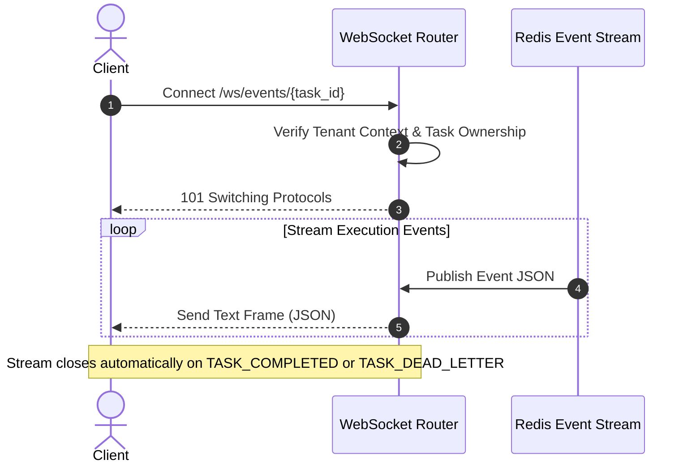

# API Reference: WebSocket Streaming

The WebSocket router provides real-time lifecycle event streaming for active background scheduling jobs.

---

## WebSocket Endpoint Connection

```text
WS /ws/events/{task_id}
```

### Connection Flow



---

## Event Payload Taxonomy

All streamed events adopt the following JSON message schema:

```json
{
  "task_id": "3d1c7c7b-6d7e-4f5a-bf1d-f7af6acdc198",
  "event_type": "LLM_COMPLETED",
  "timestamp": "2026-11-04T03:00:14.992104Z",
  "data": {
    "provider": "google_gemini",
    "tokens_used": 342,
    "parsed_summary": "Design review"
  }
}
```

### Supported Event Types

| Event Type | Description |
| :--- | :--- |
| `TASK_STARTED` | Celery worker picked up the task from Redis queue. |
| `LLM_STARTED` | Intent extraction submitted to LLM engine. |
| `LLM_COMPLETED` | Valid function-call JSON schema extracted successfully. |
| `GOOGLE_CALENDAR_STARTED` | Google Calendar API event creation request dispatched. |
| `TASK_COMPLETED` | Event created with Google Meet link. Final frame before close. |
| `TASK_FAILED_DB_ERROR` | Transient database error encountered. Retrying task. |
| `TASK_DEAD_LETTER` | Execution failed permanently. Task moved to DLQ. Final frame. |
