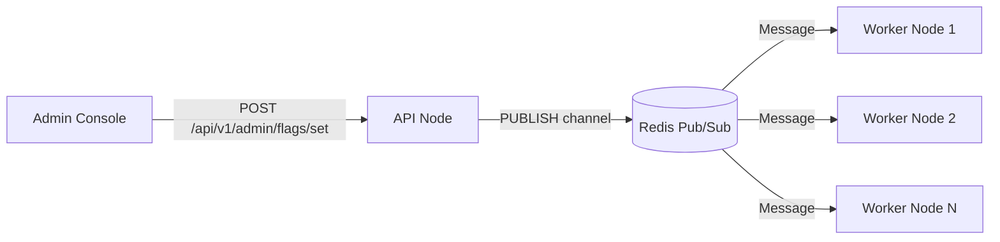

# Feature Flags & Anomaly Detection Engine

The service integrates a multi-lens system health monitoring and dynamic feature flagging architecture (`flags/engine.py`, `utilities/feature_flags.py`) that operates in real time without service interruptions.

---

## System Health Metrics & Anomaly Lenses

The `AnomalyEngine` tracks four system health indicators:

| Health Indicator | Symbol | Normal Target | Warning Threshold | Metric Source |
| :--- | :--- | :--- | :--- | :--- |
| **P95 Latency** | $L_{p95}$ | $< 1500\text{ ms}$ | $\ge 5000\text{ ms}$ | `AnomalyDetectionMiddleware` |
| **Error Rate** | $E_{rate}$ | $< 2.0\%$ | $\ge 10.0\%$ | LatencyPercentileTracker |
| **CPU Utilization** | $C_{cpu}$ | $< 60.0\%$ | $\ge 85.0\%$ | System Health Snapshot |
| **Queue Depth** | $Q_{depth}$ | $< 50\text{ tasks}$ | $\ge 200\text{ tasks}$ | Celery Broker Redis State |

---

## Composite Health Score & Circuit Breakers

The engine computes a composite health score $H \in [0, 100]$:

$$H = 100 - \left( w_1 \cdot \Delta L + w_2 \cdot E_{rate} + w_3 \cdot C_{cpu} + w_4 \cdot Q_{depth} \right)$$

### Circuit Breaker Triggering
* **Threshold**: When $H < 70.0$, the circuit breaker trips to a **HALF-OPEN** or **OPEN** state.
* **Impact**: Incoming scheduling tasks automatically throttle, background job concurrency drops, and non-essential fallback services step in.

### Dynamic Rate Limiter Adaptation
The nominal HTTP rate limit ($R_{nominal}$) scales dynamically according to current system health:

$$R_{adapted} = R_{nominal} \times \frac{H}{100}$$

---

## Real-Time Redis Pub/Sub Invalidation

Feature flag modifications initiated by administrators (`routes/feature_flags_admin.py`) broadcast immediately across all running worker nodes:

