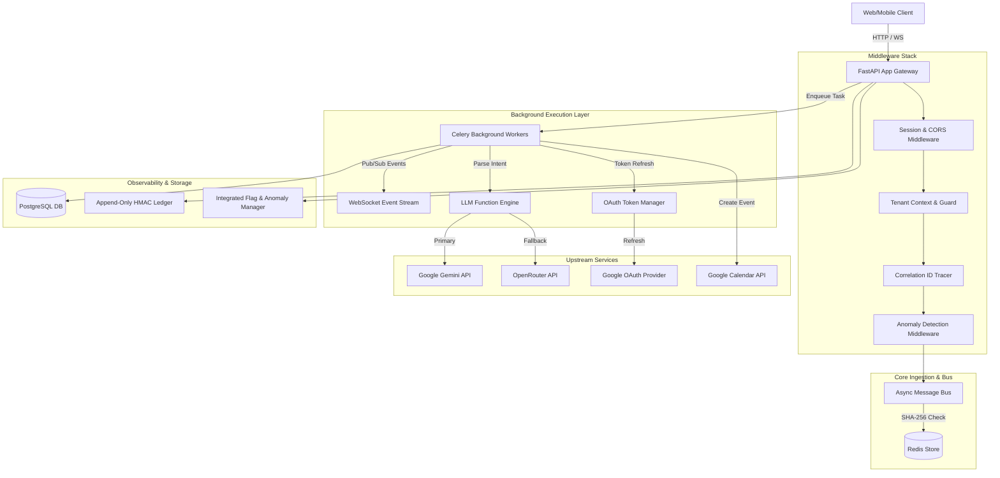

# Systems Architecture & Topology

The **Calendar Scheduling API** is architected around a layered, decoupled service structure separating HTTP request handling, security context validation, asynchronous work distribution, LLM intent parsing, and immutable telemetry recording.

---

## Component Topology

---

## Architectural Principles

### 1. Strict Layered Isolation
The codebase enforces clear separation of concerns across dedicated modules:
* `routes/`: Public HTTP API definition and dependency injection.
* `middleware/`: HTTP context assertion, rate limiting, and performance tracking.
* `messaging/`: Idempotency enforcement and payload integrity checking.
* `engine.py`: Structured LLM extraction and provider fallback orchestration.
* `tasks/`: Asynchronous job execution, token management, and dead-letter queue escalation.
* `telemetry/`: Tamper-evident ledger writing and distributed audit tracking.

### 2. High-Availability Operational Safeguards
* **Non-blocking API Gateway**: Scheduling requests return `202 Accepted` immediately upon enqueueing.
* **Pub/Sub Dynamic Configuration**: Live adjustments to rate limits, circuit breaker thresholds, and feature flags propagate across worker clusters without service restarts via Redis Pub/Sub (`utilities/feature_flags.py`).
