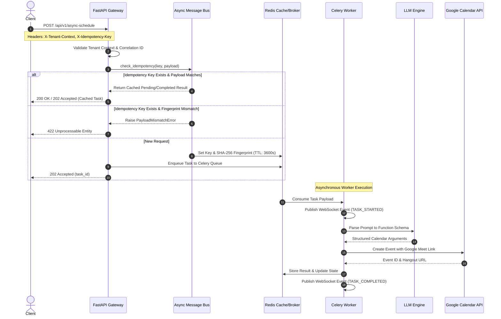

# Request Lifecycle & Asynchronous Message Bus

All scheduling operations execute asynchronously through a multi-stage request pipeline that ensures idempotency, data integrity, and strict request tracing.

---

## End-to-End Sequence Diagram

---

## SHA-256 Payload Fingerprinting & Idempotency

The `AsyncMessageBus` (`messaging/bus.py`) guarantees that duplicate network requests or retries cannot duplicate calendar appointments:

1. **Fingerprint Computation**: The raw JSON request payload is canonicalized (`sort_keys=True`) and hashed using SHA-256.
2. **Key Binding**: The calculated fingerprint is bound to the client's `X-Idempotency-Key` in Redis under `idempotency:{key}` with a default TTL of 3600 seconds (1 hour).
3. **Payload Mismatch Rejection**: Reusing an `X-Idempotency-Key` with modified prompt text or parameters triggers a `PayloadMismatchError` and yields an **HTTP 422** response, preventing replay attacks and payload tampering.

---

## Jittered Exponential Backoff

Transient execution failures within the message bus or Celery tasks apply full-jittered exponential backoff:

$$\text{Delay} = \text{random}(0, \, \min(\text{max\_backoff}, \, \text{base} \times 2^{\text{attempt}}))$$

This prevents thundering-herd scenarios during upstream Google API rate-limiting events or transient network blips.