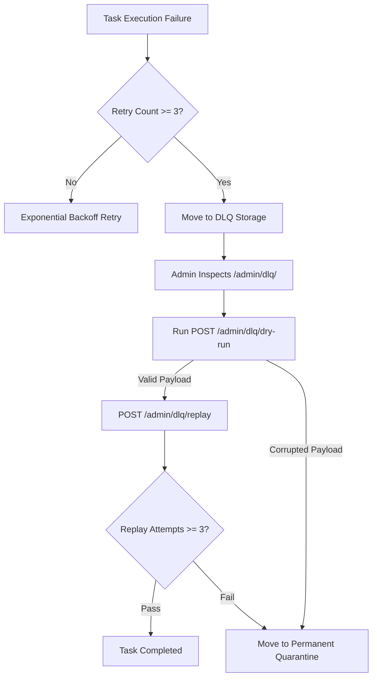

# Dead-Letter Queue & Incident Quarantine

When background tasks encounter non-retryable errors or exhaust max retry attempts, they enter the Dead-Letter Queue (DLQ).

---

## Triage & Incident Workflow

---

## 3-Retry Quarantine Rule

To protect upstream APIs from poison-pill payloads:
* Tasks attempting more than **3 manual replays** are automatically locked into **Quarantine**.
* Quarantined tasks cannot be replayed without explicit database state updates by system maintainers.
