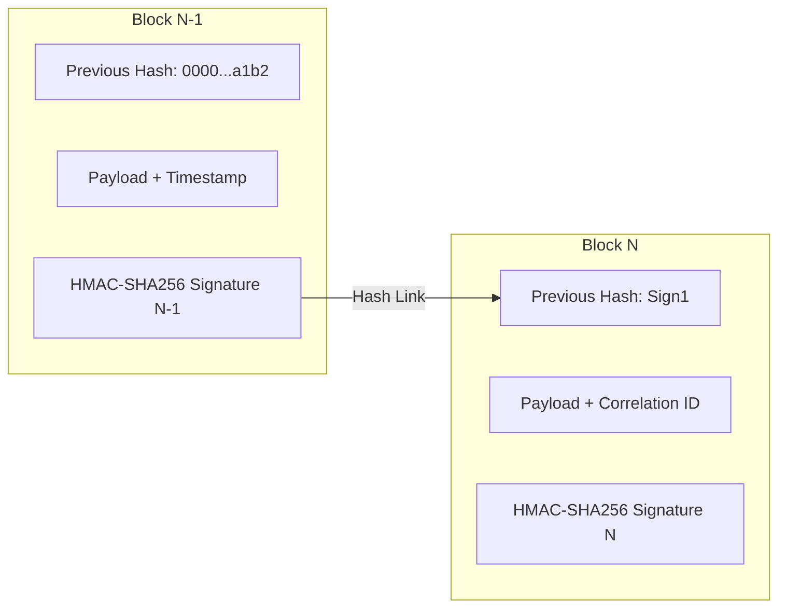

# Tamper-Evident Audit Ledger & PII Masking

The service maintains a cryptographically secured, append-only audit ledger (`telemetry/audit_ledger.py`) that logs all system actions, authentication events, and administrative overrides.

---

## HMAC-SHA256 Chained Block Architecture

The audit ledger records events to a newline-delimited JSON file (`audit_ledger.json`). Each entry constitutes an immutable block linked hash-wise to the preceding block.



### Block JSON Structure

```json
{
  "index": 1042,
  "timestamp": "2026-11-04T03:12:00.104281Z",
  "correlation_id": "corr_8f912a7c",
  "event_type": "DLQ_REPLAY_EXECUTION",
  "tenant_id": "tenant_enterprise_99",
  "payload": {
    "task_id": "3d1c7c7b-6d7e-4f5a-bf1d-f7af6acdc198",
    "replayed_by": "admin_user_12",
    "target_user_email": "[MASKED]@example.com"
  },
  "previous_hash": "e3b0c44298fc1c149afbf4c8996fb92427ae41e4649b934ca495991b7852b855",
  "hmac_signature": "7f8a91b2c3d4e5f60718293a4b5c6d7e8f901a2b3c4d5e6f7a8b9c0d1e2f3a4b"
}
```

---

## Automated PII Sanitization

All incoming event payloads pass through regex masking filters before writing to disk:

| Sensitive Field | Match Pattern | Masked Replacement Output |
| :--- | :--- | :--- |
| **Email Address** | `([a-zA-Z0-9_.+-]+)@(...)` | `[MASKED]@domain.com` |
| **Social Security Number** | `\d{3}-\d{2}-\d{4}` | `[MASKED_SSN]` |
| **Credit Card Number** | `(?:\d[ -]*?){13,16}` | `[MASKED_CC]` |
| **Phone Number** | Standard 7–11 digit formats | Digits masked, preserving final 2 digits (`***-***-**99`) |

---

## Ledger Integrity Verification

To detect manual tampering or log truncation, operators run ledger integrity validation:

```python
from telemetry.audit_ledger import AuditLedger

ledger = AuditLedger(file_path="telemetry/audit_ledger.json", hmac_key=b"master_key")
is_valid, error_block = ledger.verify_chain_integrity()
if not is_valid:
    print(f"Tampering detected at ledger block index {error_block}")
```
