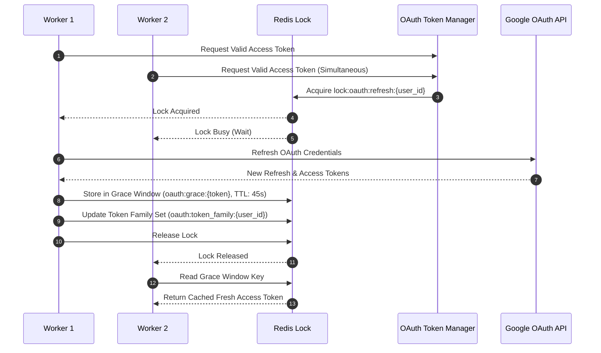

# OAuth Token Family Rotation & Grace Period

To secure Google Calendar access tokens without race conditions during concurrent worker execution, the system implements an atomic **OAuth Token Manager** (`tasks/refresh_oauth_tokens.py`).

---

## Distributed Lock & Refresh Protocol

When a background worker detects an expired or near-expired Google OAuth token:

---

## Grace Period & Compromise Quarantine

### 1. 45-Second Grace Window
When multiple workers refresh a user's token simultaneously, the first worker writes the new token pair to `oauth:grace:{old_refresh_token}` in Redis with a 45-second expiry. Subsequent workers obtain the fresh access token directly from Redis, preventing redundant OAuth token revocations.

### 2. Reuse & Compromise Detection
Every issued refresh token is tracked in a Redis family lineage set (`oauth:token_family:{user_id}`).

!!! failure "Token Reuse Alert"
    If an old, previously rotated refresh token is presented outside the 45-second grace window:
    1. The manager flags an `OAuthCompromiseException`.
    2. The entire token family set is quarantined and moved to `oauth:revoked_tokens:{user_id}`.
    3. User database credentials are immediately invalidated.
    4. An audit ledger event `OAUTH_FAMILY_COMPROMISE_REVOCATION` is emitted.
