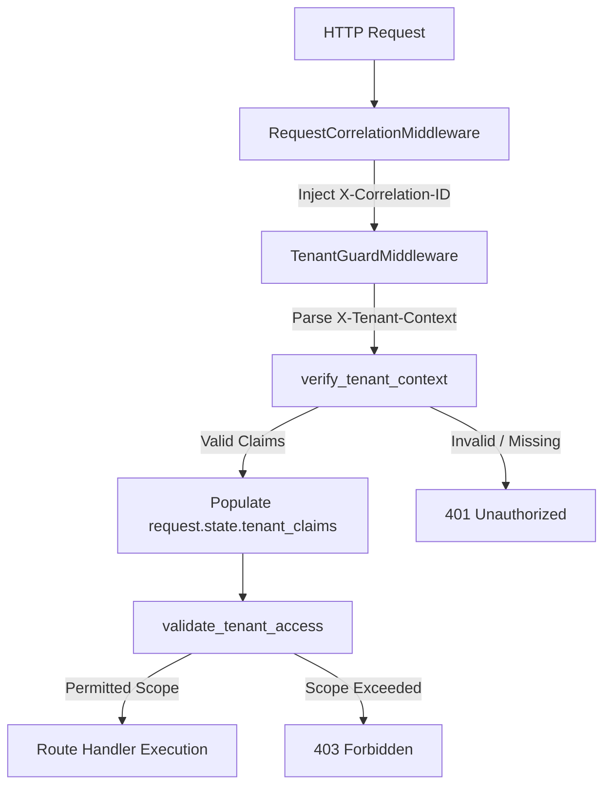

# Security, Tenant Context & RBAC

The API implements multi-tenant isolation, cryptographically signed JWT claim validation, and explicit role-based access control (RBAC).

---

## Tenant Context Pipeline

Every protected endpoint requires a signed tenant JWT context passed via the `X-Tenant-Context` HTTP header.



---

## Tenant Claims Schema & Headers

### `X-Tenant-Context` Token Schema

```json
{
  "tenant_id": "tenant_enterprise_99",
  "user_id": 4821,
  "roles": ["org_admin", "scheduler_user"],
  "bounds": {
    "allowed_operations": ["schedule:create", "schedule:read", "dlq:replay"],
    "max_attendees_per_event": 50
  },
  "exp": 1793856745
}
```

### Request Headers

| Header Name | Type | Requirement | Description |
| :--- | :--- | :--- | :--- |
| `X-Tenant-Context` | `String (JWT)` | **Required** | Signed JWT carrying tenant identity and scope bounds. |
| `X-Correlation-ID` | `String (UUID)` | Optional | Request correlation ID. Auto-generated if omitted. |
| `X-Admin-Key` | `String (Hex)` | Admin Only | 64-character master key required for administrative routes. |

---

## Distributed Correlation ID Tracing

`RequestCorrelationMiddleware` (`middleware/request_correlation.py`) ensures that every log line, database transaction, Celery worker execution, and audit log block carries a shared `X-Correlation-ID`:

```text
[2026-11-04 03:00:12] [INFO] [corr_8f912a7c] Tenant tenant_enterprise_99 enqueued scheduling task task_3d1c7c7b
[2026-11-04 03:00:13] [INFO] [corr_8f912a7c] Celery Worker starting LLM prompt parsing
[2026-11-04 03:00:15] [INFO] [corr_8f912a7c] Google Calendar event gcal_event_998234 created successfully
```
